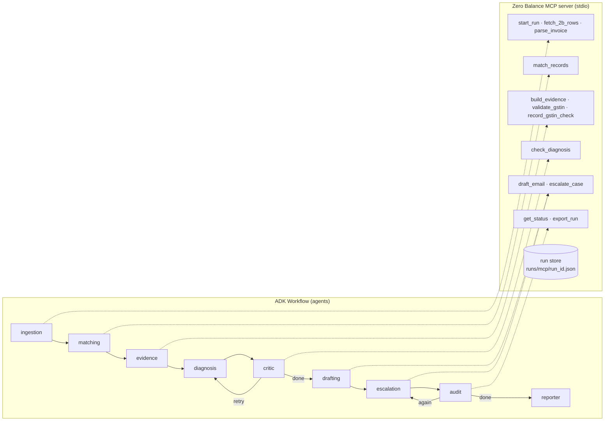

# Zero Balance as a multi-agent system: design and justification

This document explains how the single-agent reconciler became a team of single-responsibility, iterative agents
that share one MCP server. It also explains why each decision was made, and what the measurements say.

Code: `mcp_server/server.py` (tools), `multiagent/agents.py` (agents), `multiagent/workflow.py` (graph),
`multiagent/runner.py`. Run it with `python -m multiagent.runner --client c1`, or pick
**Multi-agent team (MCP, local)** in the UI.

---

## 1. Starting point and constraints

The single-agent version already worked: one ADK agent called 6 tools in sequence, a gate inside `draft_email`
blocked unsafe emails, and a done check escalated anything left undecided. It had three structural weaknesses:

1. **Mixed responsibilities.** One agent did ingestion, matching, diagnosis, drafting and escalation. A change
   to any step (say, a new parsing strategy) touched the same loop as every other step, and the trace couldn't
   say *who* decided what.
2. **No second opinion.** A diagnosis went straight to `draft_email`. The gate refused bad ones, but the item
   was then **escalated immediately**. The system never tried again with a better method, so a weak diagnoser
   meant a flooded reviewer queue (76% escalations with zero-shot MiniLM).
3. **Tools welded to one agent.** The tools lived inside the agent's process and session state, so no other
   client (another agent, Claude Desktop, an audit script) could use or inspect them.

Constraints carried over: no billed services (MiniLM runs locally), deterministic matching (the LLM-only and
embedding-only experiments showed similarity search clears wrong pairs), unsafe auto-clears must stay at 0, and
the demo must work offline.

## 2. Design process

The decomposition was done in four passes.

**Step 1: list the decisions, not the steps.** Each point where the system *decides* something became a
candidate agent: which extraction worked, which 2B row matches, what evidence exists, what caused the mismatch,
whether that diagnosis can be trusted, what to send, who must look at it, whether the run is complete.

**Step 2: apply the single-responsibility test.** An agent should have exactly one reason to change. Parsing
changes when invoice formats change; matching changes when GST rules change; diagnosis changes when the model
changes; verification changes when the risk policy changes. Steps that change for the same reason were kept
together. For example, "load 2B" and "parse PDFs" are both *ingestion*, while drafting and escalating were
kept apart because they have different consumers (vendors vs the internal reviewer) and different tools.

**Step 3: draw the trust boundary.** Everything that touches data or has a side effect moved behind an **MCP
server**. Agents became clients that only see summaries. That made least privilege enforceable: each agent
gets a whitelist of tools.

**Step 4: decide where iteration pays.** A loop is only worth adding where a second attempt can produce a
different and better answer, and where there's a clear stop condition. That gave two levels of iteration
(section 5).

## 3. Architecture

### The agents

| Agent | Single responsibility | MCP tools it may call | How it iterates | Stop condition (cap) |
|---|---|---|---|---|
| **ingestion** | clean, structured inputs | `start_run`, `fetch_2b_rows`, `parse_invoice` | re-parses only the failed files with the next extraction strategy (default → layout → words) | no failed files, or strategies exhausted (3) |
| **matching** | invoice ↔ 2B pairs | `match_records` | one deterministic pass per iteration, strongest key first | nothing left unmatched, or 4 passes run (4) |
| **evidence** | facts per open item | `build_evidence`, `validate_gstin`, `record_gstin_check` | verifies every "other GSTIN" in the evidence and records the result | no unverified GSTINs (3) |
| **diagnosis** | cause + confidence per item | *none* (reads evidence from state) | each retry uses a stronger strategy: zero-shot → few-shot | driven by the critic loop |
| **critic** | is the proposal trustworthy? | `check_diagnosis` (read-only) | accept / send back / give up, per item; routes the loop | worklist empty, or attempts exhausted |
| **drafting** | vendor drafts, next-return flags | `draft_email` | drains its queue; gate refusals go to escalation | queue empty (2) |
| **escalation** | reviewer queue | `escalate_case` | drains its queue | queue empty (2) |
| **audit** | completeness | `get_status` (read-only) | anything undecided goes back to escalation | nothing undecided (3 rounds) |
| **reporter** | run summary | *none* | single step | n/a |

Only **diagnosis** uses a learned model (MiniLM). The others are deterministic agents: each has a goal, a
loop, tools and a stop rule, but no model. That's deliberate: section 7 explains why the work that must be
exact stays deterministic.

## 4. Why an MCP server

| Need | How MCP meets it |
|---|---|
| **Least privilege** | Each agent gets a tool whitelist (`allowed_tools`); calling anything else raises `PermissionError`. The diagnoser has no tools at all, so it *cannot* send anything. |
| **One place for the safety rules** | The gate runs inside the server (`check_diagnosis` for the critic, then again inside `draft_email`). No client, agent or human tool can skip it. |
| **Reuse beyond this app** | The same server works with any MCP client: MCP Inspector, Claude Desktop, or a future LLM agent through ADK's `McpToolset`. Swapping MiniLM for an LLM diagnoser doesn't change the tools. |
| **Data out of the prompt** | Records stay in the server's run store; agents get summaries (< 2 KB). |
| **Auditability and resume** | Every write is persisted to `runs/mcp/<run_id>.json`. The server can restart mid-run and any client can resume or audit it with `get_status` / `export_run`. |
| **Process isolation** | PDF parsing and file access run in the server process (stdio), separate from the agents. |
| **Discoverable intent** | Read-only tools carry MCP's `readOnlyHint` annotation, so clients can tell observation from action. |

Tool names from the deck are kept (`parse_invoice`, `fetch_2b_rows`, `match_records`, `validate_gstin`,
`draft_email`, `escalate_case`). New tools exist only where a responsibility needed them: `start_run`,
`build_evidence`, `record_gstin_check`, `check_diagnosis`, `get_status`, `export_run`.

## 5. Iteration design

**Inside an agent:** every agent except diagnosis, critic and reporter extends `IterativeAgent`, which runs
*act → observe → decide* until its stop condition holds or it hits `max_iterations`. Every loop has a cap, so
the system always terminates, and hitting a cap is logged in the trace.

**Between agents (ADK `Workflow` routes):**

- **Diagnosis ↔ critic (propose → critique → retry).** The critic asks the server whether each proposal fits
  the evidence. Accepted items move on; a *retryable* rejection (cause disagrees with the evidence, or
  confidence below 0.75) goes back with an attempt counter; a non-retryable one (unreadable PDF) or one out
  of attempts goes to escalation with the reason. The loop ends when the worklist is empty.
- **Escalation ↔ audit (verify → repair).** The audit checks that every open item has a decision. Anything
  missing goes back to escalation as `agent_did_not_decide`. This is the done check, now a loop with its own
  agent.

**Why zero-shot first, few-shot on retry.** Zero-shot needs only the cause definitions, so it works for a new
client or a new mismatch type with no labelled history. Few-shot needs past labelled cases (precedent). The
critic consults precedent only for the items where the definitions failed. That's the order a junior
accountant follows too: apply the rule; when it doesn't fit, look at how similar cases were handled.

**Why ADK `Workflow` and not `LoopAgent`.** In the installed ADK (2.13), `LoopAgent` and `SequentialAgent` are
deprecated in favour of `Workflow`, a graph whose nodes are agents and whose edges can be **routed**. A routed
back-edge (`critic → diagnosis`) states the loop in the graph itself, which is clearer than a nested loop
container.

## 6. Safety: defence in depth

1. **Critic**: rejects proposals that disagree with the deterministic evidence or are under-confident.
2. **Server gate in `draft_email`**: checks again on the write path, so even a buggy critic can't produce an
   unsafe draft.
3. **Least privilege**: the diagnoser can't act; drafting can't escalate; escalation can't draft.
4. **Audit loop**: nothing ends undecided.
5. **Numbers from data**: email figures come from the server's records, never from an agent's text.
6. **Drafts only**: no tool sends email.

## 7. Alternatives considered

| Alternative | Why it was rejected |
|---|---|
| One LLM agent with all tools (the original design) | No separation of duties; no retry path; can't run without a working LLM endpoint. |
| An LLM "manager" that routes between agents | The routing rules are known and must be predictable for an audit; a model adds latency and non-determinism here. |
| Agents calling each other directly | Tight coupling; hidden control flow. A blackboard (ADK session state) plus explicit graph routes keeps every hand-off visible in the trace. |
| One MCP server per agent | More processes for no gain: the agents share one run, and per-agent permissions are enforced by tool whitelists. |
| Model-based matching inside an agent | Measured and rejected: embedding-only matching gave 87.1% precision with 12 silent wrong pairs. |
| Parallel diagnosis of items | Possible (each item is independent), but a single MiniLM pass over 7 items takes milliseconds; kept sequential for a readable trace. |

## 8. Evidence

Same data, same scorer (`python eval/compare_architectures.py`):

| Configuration | Match P / R | Diagnosis acc. | Unsafe auto-clears | Escalation rate | Diagnosis rounds | Time / client |
|---|---|---|---|---|---|---|
| Single agent · MiniLM few-shot | 100% / 100% | 100.0% | **0** | 43% | 1 | 3.0 s |
| Single agent · MiniLM zero-shot | 100% / 100% | 55.6% | **0** | 76% | 1 | 3.0 s |
| Multi-agent · zero-shot only (no retry) | 100% / 100% | 55.6% | **0** | 76% | 1 | 3.6 s |
| Multi-agent · few-shot only | 100% / 100% | 100.0% | **0** | 43% | 1 | 3.6 s |
| **Multi-agent · zero-shot → few-shot (default)** | 100% / 100% | **100.0%** | **0** | **43%** | 2 | 3.6 s |

What this shows:

- **The critique loop does real work.** Starting from the weak zero-shot diagnoser, the loop lifts diagnosis
  accuracy from 55.6% to 100% and cuts the reviewer's load from 76% to 43% of open items, with no labelled
  data needed on the first attempt.
- **Safety held in every configuration**: 0 unsafe auto-clears.
- **Cost of the split**: about 0.6 s more per client (MCP stdio round trips), and more tool calls (29–32 vs
  12–14) because each pass, retry and check is its own call. That's the price of a step-by-step audit trail.
- "Model calls" differ by design: the single agent counts every policy step, while the team counts only MiniLM
  diagnoses (7 per client, plus retries).

## 9. Honest limitations

- **The critic's ground truth is the rule evidence.** A diagnosis that disagrees with the rules is never
  auto-actioned. That's intentional (the model can't overrule exact evidence), but it also means the model
  can't *improve on* the rules; its value is confidence, abstention and agreement checking.
- **One learned agent.** With an LLM available, diagnosis (and the wording of drafts) could become an
  `LlmAgent` using the same MCP server through ADK's `McpToolset`, without changing any other agent.
- **Synthetic data.** Few-shot's 100% comes from evidence lines that repeat the same templates across seeds;
  real invoices would be harder.
- **Ingestion retries can't fix image-only scans**; that needs OCR. Today they're flagged, never guessed, and
  escalated.

## 10. Mapping to the deck

| Deck claim | Where it lives now |
|---|---|
| "Plans each client's run as ordered steps" | the `Workflow` graph |
| "Calls tools for parsing, matching, drafting" | MCP tools, called by the agent that owns each step |
| "Uses a confidence score to choose its next action" | critic: accept / retry / escalate |
| "Low-confidence cases go to a human reviewer with the evidence" | escalation agent + audit loop |
| "Unreadable PDFs are flagged, not guessed" | ingestion's iteration cap + non-retryable critic verdict |
