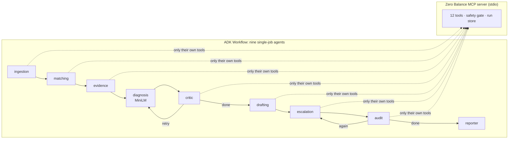

# Zero Balance: project review

**Team Zero Balance · Agentathon 2026 (Encode.ai × PES University) · as of 31 Oct 2026**

Zero Balance reconciles one client's purchase invoices against their GSTR-2B in about **3.5 seconds**. On our
synthetic test set (3 clients, 99 invoices) it scores **100% match precision and recall**, **100% diagnosis
accuracy** and **0 unsafe auto-clears**. Matching is rule-based Python. A local MiniLM model diagnoses each
mismatch. Nine single-job agents share one MCP server that owns the data, the tools and the safety gate.

Repo: <https://github.com/Saharshba/GST_Reconsiliation> (code in `zero-balance/`). Deeper design rationale:
[MULTI_AGENT_DESIGN.md](MULTI_AGENT_DESIGN.md).

---

## 1. Problem and goal

Every month, a junior accountant at a small CA firm checks each client's **purchase invoices** against the
**GSTR-2B**: the input-tax-credit statement the GST portal builds from what suppliers filed. Any invoice that
doesn't match may cost the client input tax credit. Today this is manual spreadsheet work: about **4 hours per
client per month**, for firms with 30–100 clients each. Our target is **20 minutes**.

For one client, Zero Balance:

1. reads the invoice PDFs and the GSTR-2B export,
2. matches invoices to 2B rows with deterministic rules,
3. diagnoses why each leftover invoice didn't match, with a confidence score,
4. drafts a vendor email when it's safe to (never sends it), or escalates to a human with the evidence,
5. stops only when every open item is decided.

## 2. Architecture



- **The MCP server** (`mcp_server/server.py`) owns all data and all side effects. It persists every run to
  `runs/mcp/<run_id>.json` and enforces the safety gate. Any MCP client can use it: these agents, MCP
  Inspector, Claude Desktop.
- **The agents** (`multiagent/agents.py`) each own one decision and may call only the tools that decision
  needs. They coordinate through ADK session state (a shared blackboard) and routed edges in an ADK
  `Workflow` graph; no agent calls another directly.
- **Two loops**: diagnosis ⇄ critic (propose, critique, retry with a stronger method) and escalation ⇄ audit
  (nothing ends undecided).
- **The single-agent version** (`agent/`) still exists and gives identical results; it's kept for comparison
  and as a fallback.

## 3. Data

Real invoices and 2B exports are confidential, and no public paired dataset exists, so `data/generate.py`
builds a deterministic synthetic set (seed 42) with a ground-truth answer key.

| Item | Value |
|---|---|
| Clients | 3 Karnataka SMEs (state code 29), 31 / 33 / 35 invoices |
| Vendors | 12 per client, several states, so both CGST+SGST and IGST invoices |
| Invoice PDFs | 4 layouts (table, two-column, minimal text, letterhead); 1 unreadable per client |
| GSTR-2B | official B2B JSON structure, for Sep 2026 (filing period) and Oct 2026 (next period) |
| Open items | 21 in total (7 per client); 81 correct invoice → 2B row pairs |

Planted cases (each mismatch type 3 times across the 3 clients):

| Case | Expected outcome |
|---|---|
| Exact / rounding (≤ ₹1) / format / date drift | matched by passes 1–3 |
| Near-miss number (two digits swapped) | pass-4 fuzzy match, escalated for human confirmation |
| Wrong GSTIN | email asking for a GSTR-1 correction |
| Vendor not filed | email filing reminder |
| Amount typo | email asking which figure is right |
| Period mismatch | flagged to claim in the next return |
| Unclear (conflicting evidence) | escalated |
| Unreadable PDF | escalated, never guessed |

## 4. Matching and evidence (deterministic)

The parser (`zero_balance/parsing.py`) reads PDF text with pdfplumber and label-based regexes. It picks the
supplier GSTIN as the first valid GSTIN that isn't the client's own. It gets **100% of fields right on the 96
readable PDFs** and flags all 3 unreadable ones with every field empty.

Matching (`zero_balance/matching.py`) runs four passes, strongest key first; each 2B row matches at most once:

| Pass | Rule | Confidence |
|---|---|---|
| 1 Exact | same GSTIN + raw invoice number + total | 1.00 |
| 2 Normalised | same GSTIN + normalised number + total within max(₹1, 0.1%) | 0.95 |
| 3 Date window | same GSTIN + total + date within ±5 days, exactly one candidate, amount billed once | 0.85 |
| 4 Fuzzy | same GSTIN + number similarity ≥ 85 + total within tolerance | 0.60, sent to a human |

For each open item, `zero_balance/signals.py` computes facts only (e.g. "same number and amount under another
GSTIN"). Simple rules turn them into a suggested cause: exactly one rule firing gives that cause; zero or
several give "unclear".

## 5. Diagnosis model

- **Planned:** Gemma 4 31B IT on NVIDIA's free endpoint. The API key worked, but every generation request timed
  out (504s, no reply in 150–240 s), so tool calling was never tested.
- **Used:** `sentence-transformers/all-MiniLM-L6-v2`, a small (~90 MB) sentence-embedding model that runs
  locally and offline, with no credits. It isn't a chat model: it can't call tools or write text. It only makes
  the diagnosis decision.
- **Few-shot:** compare the item's evidence to a labelled bank of 63 past cases built from seeds 1–3 (the demo
  data is seed 42, so held out); the 5 nearest cases vote.
- **Zero-shot:** compare each evidence line to short cause descriptions (from the deck's Diagnosis slide).
- **In the agent team:** zero-shot is tried first (it needs no labelled history), and few-shot is used on the
  critic's retry.

## 6. Agents

| Agent | Single job | MCP tools | Loop and stop rule |
|---|---|---|---|
| ingestion | load both 2B months, parse PDFs | `start_run`, `fetch_2b_rows`, `parse_invoice` | retries failed files with 3 extraction methods |
| matching | invoice ↔ 2B pairs | `match_records` | one pass per round, until nothing is left or 4 passes run |
| evidence | facts per open item | `build_evidence`, `validate_gstin`, `record_gstin_check` | until every other-GSTIN is verified |
| diagnosis | cause + confidence (MiniLM) | none | stronger method on each retry |
| critic | is the proposal trustworthy? | `check_diagnosis` (read-only) | accept, retry, or escalate; routes the loop |
| drafting | vendor drafts, next-return flags | `draft_email` | drains its queue |
| escalation | reviewer queue | `escalate_case` | drains its queue |
| audit | nothing left undecided | `get_status` (read-only) | sends gaps back to escalation |
| reporter | run summary | none | one step |

Only the diagnosis agent uses a learned model; the others follow fixed rules. That's deliberate: the exact work
stays deterministic and auditable (see section 9).

## 7. Safety

Unsafe auto-clears have stayed at **0 in every configuration tested**, because of five layers:

1. **Critic:** rejects any diagnosis that disagrees with the rule evidence or has confidence below 0.75.
2. **Server gate in `draft_email`:** checks again on the write path, so a buggy agent still can't draft.
3. **Least privilege:** the diagnosis agent has no tools; drafting can't escalate; escalation can't draft.
4. **Audit loop:** any undecided item is escalated as `agent_did_not_decide`.
5. **Numbers from data:** email figures come from the records, and an explanation citing an unknown figure is
   dropped. Emails are drafts only; nothing is ever sent.

## 8. Results

Same data, same scorer (`eval/compare_architectures.py`):

| Configuration | Match P / R | Diagnosis accuracy | Unsafe auto-clears | Escalation rate | Time / client |
|---|---|---|---|---|---|
| Single agent · few-shot | 100% / 100% | 100% | 0 | 43% | 3.0 s |
| Single agent · zero-shot | 100% / 100% | 55.6% | 0 | 76% | 3.0 s |
| Multi-agent · zero-shot only | 100% / 100% | 55.6% | 0 | 76% | 3.6 s |
| Multi-agent · few-shot only | 100% / 100% | 100% | 0 | 43% | 3.6 s |
| **Multi-agent · zero-shot → few-shot (default)** | **100% / 100%** | **100%** | **0** | **43%** | **3.6 s** |

The critique loop lifts the weak zero-shot diagnoser from 55.6% to 100% and cuts the reviewer's queue from 76%
to 43% of open items. The cost is one extra round and about 0.6 s per client for MCP round trips.

## 9. What didn't work

Matching invoices to 2B rows by MiniLM similarity alone (cosine ≥ 0.80, one-to-one) gave **87.1% precision**, with
**12 wrong pairs that would have cleared silently**. For example, a ₹82,280 invoice matched a ₹91,730 row at
0.992 similarity, and one invoice matched a completely different vendor. Embeddings capture meaning, not exact
numbers. That's why matching stays rule-based and the model only diagnoses. (The planned Gemma "whole job in
one prompt" baseline is written but couldn't run, because the endpoint never answered.)

## 10. Limitations and open questions

- **The test set is synthetic and easy.** Cases are planted to match our rules, and evidence lines repeat the
  same templates across seeds, so few-shot's 100% overstates real-world accuracy. The 55.6% zero-shot result is
  closer to what an untrained model does.
- **The model can't overrule the rules.** The critic judges proposals against the rule evidence. That keeps
  things safe, but the model adds confidence and abstention, not new knowledge.
- **No OCR.** Image-only scans are flagged and escalated, not read.
- **Partial GSTR-2B coverage.** Amendments (B2BA), credit notes and ISD sections aren't handled yet.
- **Untested with an LLM.** If the Gemma endpoint (or another LLM) becomes available, the diagnosis agent can
  become an LLM agent on the same MCP tools.
- **Open question for reviewers:** is a 43% escalation rate acceptable for a pilot? The 0.75 confidence
  threshold is the lever.
- **Next 30 days (from the deck):** real invoices and 2B exports from 5–10 clients, a hand-checked accuracy
  sample, and threshold tuning.

## 11. Repository and how to run it

| Path | What it holds |
|---|---|
| `data/generate.py`, `data/sample/` | synthetic data generator and the committed demo data |
| `zero_balance/` | pure-Python core: GSTIN, normalisation, parsing, 2B loader, matching, signals |
| `mcp_server/server.py` | the MCP server (12 tools, gate, run store) |
| `multiagent/` | the nine agents, the workflow graph, the runner |
| `agent/` | single-agent version, MiniLM diagnoser, tools and email templates |
| `app/streamlit_app.py` | demo UI (4 steps + Metrics; live, replay and multi-agent modes) |
| `eval/`, `experiments/` | evaluator, architecture comparison, what-didn't-work baselines |
| `tests/` | 32 tests, all offline |

```bash
cd zero-balance
.venv/bin/python -m pytest -q                      # 32 tests, offline
.venv/bin/python -m multiagent.runner --client c1  # the agent team on one client
.venv/bin/streamlit run app/streamlit_app.py       # demo UI
.venv/bin/python eval/compare_architectures.py     # the results table above
```
